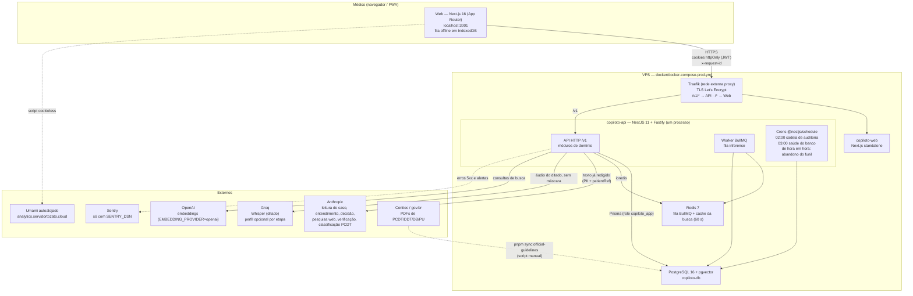

# Arquitetura — Copiloto Clínico

**Versão:** R1  
**Data:** 2026-10-16  
**Conferido contra:** `main` em 16/10/2026. O que está só em PR aberto aparece
marcado como **em PR aberto (#N)**.

O Copiloto recebe o caso clínico do plantonista, redige dado pessoal, entende o
caso, busca evidência e devolve um plano com conduta, perguntas e fontes. O
médico revisa, gera documentos (SOAP, SBAR, prescrição, alta, atestado) e os
confirma. Cada passo deixa rastro numa trilha de auditoria encadeada por hash.

Atendimentos e base de conhecimento são **multi-institucionais** (ADR-009): o
médico pertence a zero, uma ou várias instituições, e cada instituição vê o
conteúdo global mais o próprio.

---

## Diagrama C4 — Nível 2 (Containers)



### Implantação em produção

- `docker/docker-compose.prod.yml` sobe `copiloto-db`, `copiloto-redis`,
  `copiloto-api` e `copiloto-web`. O Traefik vive fora deste compose (rede
  `proxy`).
- O worker BullMQ e os crons rodam **dentro** do processo da API. Não há
  container de worker separado (o runbook, em "Containers de produção", diz
  por quê e o que seria preciso para separar).
- O compose repassa à API só as variáveis que lista. Ele **não** repassa
  `MINIO_*`, de propósito: em produção o PDF do documento é gerado sob demanda
  no download, e nada do documento clínico fica fora do banco. O `SENTRY_DSN`
  é repassado; o Sentry liga quando o valor está no `.env.production`.
- A configuração real de produção fica em `docker/.env.production`, fora do
  repositório. Os padrões abaixo são os do código e do compose.

---

## Mapa de módulos

Módulos em `src/modules/`, registrados em `src/app.module.ts`. Guards: `JwtAuthGuard`
(médico logado), `RolesGuard` (`PHYSICIAN`, `COMPLIANCE`, `ADMIN`),
`CuratorGuard` (`physicians.is_curator`) e `InternalServiceGuard`
(cabeçalho `x-internal-token`).

| Módulo          | Responsabilidade                                                                                                            | Endpoints principais (prefixo `/v1`)                                                                                                                                                                         | Entidades                                                                       |
| --------------- | --------------------------------------------------------------------------------------------------------------------------- | ------------------------------------------------------------------------------------------------------------------------------------------------------------------------------------------------------------ | ------------------------------------------------------------------------------- |
| `auth`          | Cadastro, login, refresh, sessões, MFA (TOTP + códigos de backup), bloqueio por tentativas, login com Google ou Microsoft (CC-334) | `/auth/register`, `/auth/login`, `/auth/refresh`, `/auth/logout`, `/auth/me`, `/auth/me/sessions`, `/auth/mfa/*`, `/auth/admin/users/*/mfa-reset`, `/auth/oauth/*` | Physician, RefreshToken, MfaBackupCode, LoginSecurityState, ExternalIdentity |
| `beta`          | Beta por convite: convite, lista de espera, termo e perfil do beta, ativação (CC-702)                                       | `/beta/registration`, `/beta/waitlist`, `/beta/me`, `/beta/me/terms`, `/beta/me/profile`, `/admin/beta/{invites,waitlist,activation}` | BetaInvite, BetaParticipant, BetaWaitlistEntry |
| `legal`         | Termos de Uso e Política de Privacidade versionados, aceite no próximo acesso (CC-905)                                      | `/legal/status`, `/legal/acceptances`, `/admin/legal/documents`                                                              | LegalDocument, LegalAcceptance |
| `practice-sites`| Locais de plantão do médico, levados à decisão com `COPILOT_SITE_CONTEXT` (CC-602)                                        | `/physicians/me/practice-sites`                                                                                              | PracticeSite |
| `physicians`    | Verificação de CRM (pedido do médico, fila do admin, checagem automática opcional por `CRM_VERIFICATION_URL`)               | `/physicians/me/crm-verification`, `/admin/crm-verifications`                                                                                                                                                | CrmVerificationRequest                                                          |
| `institutions`  | Instituições e vínculo médico↔instituição (ADR-009)                                                                         | `GET /institutions/mine`; criação e vínculo só com token interno                                                                                                                                             | Institution, PhysicianInstitution                                               |
| `encounters`    | Atendimentos (com ou sem `patientRef`), anexos de referência por atendimento                                                | `/encounters`, `/encounters/stats`, `/encounters/:id`, `/encounters/:id/attachments`                                                                                                                         | Encounter, EncounterAttachment                                                  |
| `copilot`       | Análise clínica: copiloto guiado, etapas, decisão, decisões por recomendação, feedback, "não encontrei", motor de protocolo | ver "Fluxo principal"; `/encounters/:id/copilot/decisions`, `/encounters/:id/copilot/feedback`, `/encounters/:id/copilot/knowledge-gaps`, `/admin/copilot-feedback`, `/encounters/:id/protocol-runs`, `/protocol-runs/:runId/*` | CaseIntake, AiInteraction, RecommendationDecision, CopilotFeedback, KnowledgeGap, ProtocolRun |
| `mentoring`     | "Discutir com um médico da equipe": caso mascarado vai aos mentores (CC-707), atrás de `COPILOT_MENTORING`               | `/encounters/:id/mentoring`, `/mentoring/queue`, `/mentoring/requests/:id/*`, `/mentoring/{config,notifications}`, `/admin/mentoring`       | MentoringRequest |
| `shift-review`  | "Revise seu plantão": perguntas sobre os próprios casos com grau de certeza (CC-801), atrás de `COPILOT_SHIFT_REVIEW`      | `/shift-review/current`, `/shift-review/questions/:questionId/answer`                                                        | ShiftReview, ShiftReviewQuestion |
| `ai-gateway`    | Um ponto de saída para os modelos: perfis de provedor, saída estruturada, fallback de recusa, embeddings, rastro `ai_calls` | —                                                                                                                                                                                                            | AiCall                                                                          |
| `guidelines`    | Base de conhecimento: busca, consulta dentro do caso, sugestão do médico, ingestão e curadoria, base oficial da Conitec     | `/guidelines`, `/guidelines/search`, `/guidelines/consult`, `/guidelines/suggest`, `/guidelines/extract-text`, `/guidelines/pending`, `/guidelines/chunks/:id/{approve,reject}`, `/guidelines/ingest-review` | GuidelineChunk, OfficialGuidelineDocument                                       |
| `knowledge-cards` | Cartões revisados: rascunho por IA com citação literal, versões, revisão e aprovação (ADR-019)                           | `/admin/knowledge-cards`, `/admin/knowledge-cards/drafts`, `/admin/knowledge-cards/:id/{versions,submit,approve,reject,archive}` | KnowledgeCardDraft, KnowledgeCard, KnowledgeCardVersion |
| `protocols`     | Protocolos versionados em árvore de decisão (ADR-007)                                                                       | `/protocols`, `/protocols/:id`, `/protocols/:id/{publish,revise}`                                                                                                                                            | Protocol, ProtocolNode, ProtocolEdge                                            |
| `documents`     | Geração, edição, confirmação e PDF de documentos clínicos                                                                   | `/encounters/:id/documents`, `/encounters/:id/documents/:docId`, `.../confirm`, `.../download`                                                                                                               | Document                                                                        |
| `audio`         | Ditado (transcrição direta, sem gravar áudio) e captura de áudio cifrada                                                    | `POST /audio/transcribe`, `POST /encounters/:id/audio`                                                                                                                                                       | AudioCapture                                                                    |
| `queue`         | Fila `inference` (BullMQ): análise assíncrona e pós-transcrição                                                             | `POST /encounters/:id/copilot/analyze/async`, `GET /encounters/:id/copilot/jobs/:jobId`                                                                                                                      | —                                                                               |
| `audit`         | Trilha append-only, consulta, exportação CSV, verificação da cadeia                                                         | `GET /audit`, `GET /audit/export` (COMPLIANCE/ADMIN), `POST /audit/verify-chain` (interno)                                                                                                                   | AuditLog                                                                        |
| `lgpd`          | Consentimento, exportação e eliminação dos dados do médico                                                                  | `/lgpd/consent`, `/lgpd/export`, `/lgpd/erasure`                                                                                                                                                             | Consent                                                                         |
| `mail`          | E-mail transacional por SMTP (CC-015); sem `SMTP_HOST`, cada envio vira só uma linha de log                                | `POST /admin/mail/test`                                                                                                      | — |
| `analytics`     | Estatísticas, funil de produto (F5) e custo de IA por médico                                                                | `/analytics/stats`, `/analytics/funnel`, `/analytics/cost` (ADMIN/COMPLIANCE)                                                                                                                                | —                                                                               |
| `observability` | Métricas de inferência e checagem de saúde do banco                                                                         | `GET /admin/metrics/inference`, `POST /admin/backup-health/check` (internos)                                                                                                                                 | —                                                                               |
| `storage`       | Object storage S3/MinIO para PDFs; desligado sem `MINIO_*`                                                                  | —                                                                                                                                                                                                            | —                                                                               |
| `redis`         | Cliente Redis do cache da busca e do health check                                                                           | —                                                                                                                                                                                                            | —                                                                               |
| `health`        | Health check (banco e Redis)                                                                                                | `GET /health`                                                                                                                                                                                                | —                                                                               |

Transversais em `src/shared/`: contratos Zod compartilhados com o web
(`contracts/clinical.ts`, importados como `@contracts/*`), `CryptoService`
(AES-256-GCM com `FIELD_ENCRYPTION_KEY`), `RequestContextInterceptor`
(`x-request-id`), `PiiLogSanitizerInterceptor` (log de acesso) e
`SentryExceptionFilter`. O limite de requisições (`ThrottlerModule`) fica em
memória do processo, não no Redis.

---

## Flags da análise clínica

Trocar é só de env, sem rebuild (`up -d copiloto-api`). As flags de escolha
usam `readBooleanFlag`/`readChoiceFlag` (`src/config/feature-flag.ts`): valor
desconhecido cai no padrão.
Detalhes e logs em `docs/runbook.md`, seção "Variáveis de Ambiente Críticas".

| Flag                                               | Padrão                | O que liga                                                                       |
| -------------------------------------------------- | --------------------- | -------------------------------------------------------------------------------- |
| `COPILOT_INTAKE`                                   | `off`                 | Copiloto guiado: leitura do caso e até 3 perguntas antes do plano (ADR-014)      |
| `COPILOT_REASONING`                                | `legacy`              | `stages`: Etapa 1 (entendimento) e busca dirigida por hipótese (ADR-013)         |
| `COPILOT_DECISION_PROMPT`                          | `v1`                  | `v2`, `v3`, `v4`: decisão em duas camadas; exigem `stages`                       |
| `COPILOT_KNOWLEDGE_SOURCE`                         | `internal_kb`         | `model_only`, `web` (pesquisa antes da decisão) ou `verify` (verificação depois) |
| `AI_DECISION_MODEL` / `AI_DECISION_CRITICAL_MODEL` | vazios (= `AI_MODEL`) | Modelo da decisão por gravidade (ADR-016)                                        |
| `COPILOT_WHY_LINE`                                 | `off`                 | Linha de "por quê" em cada conduta do "Fazer agora" (CC-601); exige `v3` ou `v4` |
| `COPILOT_SITE_CONTEXT`                             | `off`                 | Local de plantão e regra de transferência na decisão (CC-602, CC-603)            |
| `AI_FALLBACK_MODEL`                                | vazio (sem reserva)   | Modelo de reserva quando o provedor da etapa cai (CC-107)                        |
| `DEID_CONTEXT_RULES`                               | `on`                  | Máscara de prontuário pelo rótulo e de nome após tratamento ou apelido (CC-201)  |
| `OFFICIAL_GUIDELINES_ENABLED`                      | `true`                | Base oficial do MS no retrieval (ADR-010)                                        |
| `UNREVIEWED_SOURCES_PRELIMINARY`                   | `true`                | Fonte não revisada sempre preliminar (ADR-012)                                   |
| `EMBEDDING_PROVIDER`                               | `openai` no compose   | `none` desliga todo embedding: a análise segue sem trechos da base               |

A ADR-013 registra a configuração decidida para produção em 11/10/2026:
`stages`, `v3` e `model_only`.

---

## Gateway de IA: perfis por etapa e rastro

Toda chamada a modelo passa por `AiGatewayService` (`src/modules/ai-gateway`).

- **Provedor padrão:** `AI_PROVIDER` (`anthropic` pelo SDK oficial, ou `openai`
  por HTTP) com `AI_MODEL`.
- **Perfis nomeados:** `AI_PROVIDER_PROFILES=groq` cria o perfil `groq`, com
  `AI_PROVIDER_GROQ_KIND`, `_API_KEY`, `_BASE_URL` etc. Cada etapa escolhe o
  provedor pela referência do modelo: `groq:openai/gpt-oss-120b` vai para o
  perfil `groq`; sem prefixo conhecido, vai para o provedor padrão. A Groq usa
  o provedor compatível com a OpenAI (`AI_PROVIDER_GROQ_KIND=openai`). Perfil
  sem `KIND` ou `API_KEY` derruba a API na subida.
- **Modelo por etapa:** `AI_INTAKE_MODEL` (leitura do caso),
  `AI_UNDERSTANDING_MODEL` (Etapa 1), `AI_DECISION_MODEL` e
  `AI_DECISION_CRITICAL_MODEL` (decisão), `AI_RESEARCH_MODEL` (pesquisa web, só
  Anthropic) e `AI_VERIFY_ATTACH_MODEL` (verificação). Todos aceitam
  `perfil:modelo`.
- **Embeddings:** `EMBEDDING_PROVIDER` (`openai` ou `none`), modelo
  `AI_EMBEDDING_MODEL` (`text-embedding-3-small`). A Anthropic não tem
  embedding.
- **Rastro `ai_calls`:** `TracingAiProvider` envolve cada provedor e
  `AiCallLogService` grava uma linha por chamada: etapa (`intake_reading`,
  `understanding`, `decision`, `research`, `verify_attach`,
  `guideline_classification`, `other`), perfil, provedor, modelo pedido e
  servido, esforço, SHA-256 do system prompt, tokens, custo, latência e
  desfecho. Nenhum texto do caso, do prompt ou da resposta. A gravação não
  espera nem falha a análise (`AI_CALL_LOG_FAILED` vira WARN).
- **`x-request-id`:** `RequestContextInterceptor` aceita o id do cliente
  (8–64 caracteres seguros) ou gera um UUID, devolve no cabeçalho e o guarda
  num `AsyncLocalStorage`. O mesmo id vai para `ai_calls.request_id`,
  `ai_interactions.request_id` e para a linha de log `AI_CALL`.

---

## Fluxo principal: análise clínica em etapas

A tela `/encounters/:id/conversation` usa o caminho do copiloto guiado
(ADR-014). Com `COPILOT_INTAKE=off` a conversa existe do mesmo jeito, mas sem
leitura: o caso vai direto ao plano.

```
Médico escreve ou dita o caso (ditado: POST /audio/transcribe → Groq Whisper,
o texto volta com maskPII e o áudio não é gravado)
        ↓
[FE] POST /v1/encounters/:id/copilot/intake
        ↓
[copilot/intake — IntakeService.start]
  1. Posse do atendimento (médico dono) e patientRef
  2. screenClinicalText: maskPII (CPF, CNPJ, CNS, telefone, e-mail, CEP,
     data de nascimento, RG) → redactPatientRef → scanForInjection
     (injeção: 4xx + PROMPT_INJECTION_DETECTED, antes de qualquer modelo)
  3. COPILOT_INTAKE=on: leitura do caso (etapa intake_reading, teto de 20 s)
     → portão em código (intake-gate.ts):
       instável → plano direto · nada a perguntar → plano direto
       tempo-crítico → até 1 pergunta · demais → até 3 perguntas
     Leitura que falha ou estoura o prazo → reading_failed → plano direto
  4. Grava case_intakes (caso e respostas já redigidos) + COPILOT_INTAKE_STARTED
        ↓
[FE] POST .../intake/:intakeId/answers (uma por vez) ou .../skip
     Resposta grave (opção urgente ou sinal vital de instabilidade) encerra
     as perguntas. Na trilha vai só o hash da resposta.
        ↓
[FE] GET .../intake/:intakeId/stream (SSE, só com o id; nenhum texto na URL)
        ↓
[copilot/orchestrator — analyzeScreenedStream]
  5. Etapa 1 — Entendimento (COPILOT_REASONING=stages, etapa understanding):
     CaseUnderstanding (síndrome, instabilidade, timeCritical, hipóteses
     graves e prováveis, dados que faltam, consultas de busca). Sem
     respostas, reaproveita a leitura do caso. Evento SSE `understanding`.
  6. Evidência (COPILOT_KNOWLEDGE_SOURCE):
     internal_kb → busca híbrida (pgvector + tsvector + RRF) pelas consultas
                   do entendimento (legacy: pelo texto redigido), filtrada
                   por instituição, mais a base oficial do MS; cache de 60 s
     model_only  → nenhuma busca
     web         → pesquisa Anthropic (web_search/web_fetch) em domínios
                   oficiais, só com o entendimento, nunca o texto do caso
     verify      → nenhuma busca antes da decisão (ver passo 10)
     + anexos do médico neste atendimento (fonte não curada)
  7. Modelo da decisão por gravidade (ADR-016): instável, tempo-crítico ou sem
     entendimento → AI_DECISION_CRITICAL_MODEL; senão AI_DECISION_MODEL
  8. Decisão (etapa decision, prompt v1–v4) por streaming: eventos `delta`
  9. Validação do JSON e das regras; inválido → 1 nova tentativa sem
     streaming, com o erro como feedback
 10. Verificação (só verify): pesquisa + etapa verify_attach ligam cada
     conduta a um trecho citado; nunca bloqueia
 11. Enriquecimento: fontes resolvidas e contenção determinística
     (preliminary-containment.ts). v1: fonte não revisada e anexo saem
     preliminares (ADR-012). v2–v4: preliminar é camada depends, dose sem
     fonte, anexo ou divergência da verificação; a origem vira rótulo
 12. Grava ai_interactions (inputRedacted, rawOutput, citações, params,
     custo, request_id); encounter → in_review; queixa principal;
     COPILOT_QUESTIONS_EMITTED na trilha
        ↓
[FE] Evento `done` com o plano. Reanálise: POST .../copilot/respond/stream
     (respostas no corpo, até COPILOT_MAX_TURNS=5 rodadas)
```

Cada chamada a modelo dos passos 3, 5, 6 (pesquisa web), 8, 9 e 10 grava uma
linha em `ai_calls` com o mesmo `request_id`. Embeddings não entram no rastro.

### Outras entradas da análise

| Rota                                                     | Uso                                               | Observação                                                            |
| -------------------------------------------------------- | ------------------------------------------------- | --------------------------------------------------------------------- |
| `POST .../copilot/intake/:intakeId/analyze`              | Reserva da conversa quando o SSE cai              | Mesmo pipeline, sem streaming                                         |
| `POST .../copilot/analyze`                               | Fila offline do web e clientes antigos            | Faz os passos 2 e 5–12                                                |
| `POST .../copilot/analyze/async`                         | Análise pela fila BullMQ                          | Grava o caso já redigido numa conversa (`case_intakes`) e enfileira só ids (CC-011) |
| `POST .../copilot/respond`                               | Reanálise sem streaming                           | Mesmo caminho de `respond/stream`                                     |
| `GET .../copilot/latest`, `GET .../copilot/conversation` | Recarregar a última análise ou a conversa inteira | Leitura                                                               |

---

## Fluxo: confirmação de documento

```
Médico gera o documento (exige patientRef no atendimento)
        ↓
[FE] POST /v1/encounters/:id/documents  { type }
        ↓
[documents/service — generate]
  1. Idempotente por (encounterId, type): devolve o existente
  2. Gera a partir do rawOutput da AiInteraction informada (ou da última)
  3. SOAP, SBAR e alta recebem o registro de uso de IA (Res. CFM 2.454/2026)
  4. Selo: sealContent(content) → JSON canônico RFC 8785 → SHA-256
     (contentHash v2, ADR-018) + DOCUMENT_GENERATED (com o selo)
        ↓
[FE] PATCH .../documents/:docId  { physicianEdits }  (DOCUMENT_EDITED)
        ↓
[FE] POST .../documents/:docId/confirm
        ↓
[documents/service — confirm]
  1. Autor confirma; outro médico só se for da mesma instituição do
     atendimento (cobertura de plantão)
  2. Já confirmado → 409
  3. Edição salva sem a estrutura da geração (lista achatada em texto) tem os
     campos estruturados restaurados (restoreStructuredFields)
  4. Selo: sealContent(physicianEdits ?? content) → contentHash v2
  5. Grava confirmedBy, confirmedAt, contentHash, contentHashVersion (e as
     edições restauradas, quando houve); encounter → finalized
  6. DOCUMENT_CONFIRMED com o selo, encounterId, autor, uncertain,
     uncertaintyReason da última análise e restoredFields, se houve
  7. Com storage configurado, sobe o PDF em segundo plano (pdfObjectKey)
        ↓
[FE] GET .../documents/:docId/download
     URL pré-assinada (15 min) ou, sem storage, PDF gerado na hora

GET .../documents/:docId/integrity
  → recalcula o selo com o algoritmo da versão gravada (v1 legado ou v2)
  → intact | mismatch | unconfirmed; mismatch vai para o Sentry só com ids
```

Limites conhecidos do selo (ADR-018):

- Documentos confirmados antes do v2 seguem verificáveis pelo algoritmo v1,
  congelado só para verificação. Nele, os itens de `medicamentos` da
  prescrição entraram no hash como `{}`: prescrições v1 confirmadas sem edição
  não têm os campos dos medicamentos no selo.
- O selo é calculado sobre o texto em claro. Com `CLINICAL_TEXT_ENCRYPTION=on`
  (CC-207, ADR-021), a extensão do Prisma decifra o conteúdo antes da
  verificação.
- `/integrity` atende só o autor do documento; o PDF imprime o hash sem a
  versão.

---

## Trilha de auditoria — invariantes (ADR-002, ADR-015)

```
┌──────────────────────────────────────────────────────────────────┐
│                          audit_log                               │
│                                                                  │
│  id │ actor_id │ action │ entity │ before_hash │ after_hash │ v  │
│                                                                  │
│  texto[N]  = JSON canônico (chaves ordenadas em todos os níveis) │
│              de {actorId, action, entity, entityId, payload,     │
│              timestamp, hashVersion: 2}                          │
│  after_hash[N]  = SHA256(texto[N])                               │
│  before_hash[N] = SHA256(after_hash[N-1] + texto[N])             │
│  payload gravado como o MESMO texto (::jsonb, SQL cru)           │
│                                                                  │
│  hash_version NULL = legado: o verificador reconstrói a ordem    │
│  das chaves e os vizinhos de cada número; "não verificável"      │
│  é estado conhecido e não alarma                                 │
│                                                                  │
│  ⛔ UPDATE/DELETE bloqueados por trigger                          │
│  ⛔ UPDATE, DELETE e TRUNCATE revogados da role copiloto_app      │
│  🔒 Escrita serializada por advisory lock transacional            │
│  🔄 Verificação diária às 02:00 UTC (AuditChainCronService)       │
└──────────────────────────────────────────────────────────────────┘
```

- Só cadeia rompida alarma: log `AUDIT CHAIN INTEGRITY FAILURE` e alerta no
  Sentry (quando há DSN), só com ids e contagens.
- A eliminação LGPD não alcança a trilha. Texto livre e dado pessoal em
  payloads antigos: ver `docs/compliance/LGPD.md`.

---

## Filas, workers e crons

Tudo roda no processo da API.

| Componente                                          | Agenda                                               | O que faz                                                                                                                                                                                               |
| --------------------------------------------------- | ---------------------------------------------------- | ------------------------------------------------------------------------------------------------------------------------------------------------------------------------------------------------------- |
| `InferenceWorkerService` (BullMQ, fila `inference`) | contínuo; `INFERENCE_QUEUE_CONCURRENCY=2`, 10 jobs/s | `analyze`: confere o consentimento de IA e analisa pela conversa do `intakeId` (o mesmo plano sem streaming da tela). `transcribe`: lê a transcrição já gravada da `AudioCapture` e segue o mesmo caminho. Pedido e resultado só com ids. 3 tentativas com backoff (recusa 4xx sem retry); job concluído fica 24 h e falho 7 dias no Redis |
| `AudioRetentionCronService`                         | de hora em hora (minuto 15, UTC)                     | Apaga o áudio das capturas com `retain_until` vencido (30 dias) e grava `AUDIO_RETENTION_PURGE` na mesma transação                                                                                    |
| `AuditChainCronService`                             | 02:00 UTC                                            | Verifica a cadeia inteira (ADR-015)                                                                                                                                                                     |
| `BackupHealthCronService`                           | 03:00 UTC                                            | Ping e contagem das tabelas críticas. Não faz backup                                                                                                                                                    |
| `FunnelAbandonmentCronService`                      | de hora em hora                                      | Taxa de abandono do loop de decisão em 24 h; acima de 30%, WARN e alerta no Sentry só com números                                                                                                       |
| `AiCallAlertsCronService`                           | a cada 5 minutos (UTC)                               | Custo do dia e p95 da decisão contra `AI_DAILY_COST_ALERT_USD` e `AI_P95_ALERT_MS` (CC-005); vazios = sem alerta. Só números |
| `ShiftReviewCronService`                            | segunda, 10:00 (America/Sao_Paulo)                   | Revisão semanal do plantão (CC-801); não roda com `COPILOT_SHIFT_REVIEW` desligada |

A sincronização da base oficial (`pnpm sync:official-guidelines`) e a ingestão
em lote (`pnpm ingest:guidelines`) são scripts manuais, sem agenda.

---

## Base de conhecimento

| Fonte                             | Status do chunk                                           | Como entra                                                                                   | Na análise                                                                                                                                   |
| --------------------------------- | --------------------------------------------------------- | -------------------------------------------------------------------------------------------- | -------------------------------------------------------------------------------------------------------------------------------------------- |
| Curada (pública ou institucional) | `pending_review` → `approved` / `rejected` / `superseded` | Ingestão interna, ingestão do curador ou sugestão do médico; aprovação por curador (ADR-008) | Citável. Sem aprovação de médico com CRM verificado, vira `curated_unsigned`: preliminar na decisão v1 (ADR-012), rótulo de origem nas v2–v4 |
| Oficial do MS (PCDT, DDT, DB, PU) | `official_unreviewed`                                     | Script de sync da Conitec; versão por SHA-256 do PDF, classificação por LLM (ADR-010)        | Busca separada com pisos `OFFICIAL_*`; preliminar na v1 com a contenção ligada (ADR-012), rótulo de origem nas v2–v4                         |
| Anexo do médico                   | — (tabela `encounter_attachments`)                        | Upload no atendimento; guarda só o texto extraído e mascarado                                | Só neste atendimento; nunca conduta definitiva                                                                                               |
| Pesquisa web                      | —                                                         | Ferramentas de servidor da Anthropic, lista de domínios oficiais                             | Origem `web_official` (modos `web` e `verify`)                                                                                               |

- **Multi-institucional (ADR-009):** `institution_id` NULL é conteúdo global. A
  busca filtra `institution_id IS NULL OR institution_id = :id` no SQL, nas
  duas pernas da busca híbrida. A instituição do atendimento vem do pedido
  (validada) ou da única instituição do médico; com zero ou várias, NULL.
- **Busca:** semântica (pgvector, `vector(1536)`, ivfflat com `probes = 100`)
  mais lexical (`text_tsv` gerada, índice GIN), fundidas por RRF, com pisos
  de relevância (`RETRIEVAL_*`). Com `EMBEDDING_PROVIDER=none` (ou o provedor
  fora do ar), a análise segue sem trechos (cobertura `none`) e a consulta
  de diretrizes vira busca por palavra-chave.
- **Roteamento por documento PCDT (ADR-011):** proposto, não implementado.
- **Protocolos (ADR-007/ADR-008):** árvores versionadas (`question`, `action`,
  `outcome`) com `draft` → `published` → `retired`; o motor de execução guia o
  médico passo a passo de forma determinística (`protocol_runs`), sem LLM.

---

## Observabilidade

- **Logs:** `Logger` do NestJS no stdout do container. O log de acesso
  (`HttpAccess`) tira a query string do caminho. Em erro, ele registra só os
  nomes dos campos do corpo (`bodyFields=…`), nunca os valores.
- **Linhas estruturadas sem texto clínico:** `AI_CALL`, `DECISION_MODEL`,
  `INTAKE_READING`, `INTAKE_STARTED`, `INTAKE_CLOSED`,
  `DECISION_PIPELINE_DOWNGRADE`, `WEB_RESEARCH*`, `OUTPUT_VALIDATION_WARNING`.
  O catálogo com ações fica no runbook.
- **Sentry (API e web):** só liga com `SENTRY_DSN`; captura exceções 5xx e
  alertas pontuais (crons, pesquisa web, verificação, embedding fora do ar).
  O `beforeSend` (`scrubSentryEvent`, `sendDefaultPii: false`) tira corpo,
  query, cookies e cabeçalhos de credencial do evento.
- **`ai_calls` + `x-request-id`:** custo, latência e desfecho por etapa e
  modelo; consultas prontas no runbook ("Rastro das chamadas de IA").
- **Analytics de produto:** Umami autoalojado (script cookieless, configurado
  na imagem do web por `NEXT_PUBLIC_UMAMI_*`) e o funil do servidor
  (`GET /analytics/funnel`): loop de decisão (análise → perguntas → respostas
  → reanálise → conduta → confirmação) e ativação (cadastro → 1º atendimento
  → 1ª análise → 1ª confirmação), só com contagens e durações.
- **Métricas de inferência:** `GET /admin/metrics/inference` (24 h e 7 dias,
  p95/p99, custo por modelo, a partir de `ai_interactions`).

---

## Modelo de dados simplificado

```
Institution ──┬── PhysicianInstitution ── Physician
              ├── Encounter (institution_id opcional)
              ├── Protocol
              └── GuidelineChunk

Physician ──┬── Encounter ──┬── CaseIntake ─ analysis_interaction_id ─┐
            │               ├── AiInteraction ◄───────────────────────┘
            │               │     ├── (pai/filho: turnos de reanálise)
            │               │     ├── RecommendationDecision
            │               │     ├── CopilotFeedback
            │               │     └── KnowledgeGap
            │               ├── Document
            │               ├── EncounterAttachment
            │               ├── AudioCapture
            │               ├── MentoringRequest (quem pede e o mentor)
            │               └── ProtocolRun ── Protocol ── ProtocolNode ── ProtocolEdge
            ├── ShiftReview ── ShiftReviewQuestion (aponta o atendimento e a análise)
            ├── PracticeSite
            ├── Consent, LegalAcceptance ── LegalDocument
            ├── RefreshToken, MfaBackupCode, ExternalIdentity
            ├── BetaParticipant ── BetaInvite
            └── CrmVerificationRequest

OfficialGuidelineDocument ── GuidelineChunk (uma versão por SHA-256 do PDF)
KnowledgeCard ── KnowledgeCardVersion ── KnowledgeCardDraft (rascunho da IA)
BetaWaitlistEntry (e-mail de quem ainda não tem conta; sem FK)

Sem FK, de propósito:
  AuditLog            append-only; liga por actor_id/entity_id
  AiCall              metadados por chamada de IA; liga por request_id
  LoginSecurityState  bloqueio por tentativas; chave = SHA-256 do e-mail
```

Apagar um `Encounter` apaga em cascata as interações, conversas, documentos,
anexos, capturas de áudio, execuções de protocolo, decisões e feedback dele.
`AuditLog` e `AiCall` ficam.

---

## Decisões de design

### Por que NestJS + Fastify?

NestJS dá injeção de dependência e módulos bem definidos. A auditoria é
transversal (`AuditModule`) e o Fastify sustenta o streaming SSE das análises.

### Por que Prisma + PostgreSQL?

pgvector põe a busca semântica no mesmo banco relacional. O Prisma tipa o
acesso ao banco. O Postgres tem os triggers e GRANTs que garantem o
append-only (AUD-001). Exceção: a trilha grava por SQL cru, porque o Prisma
reescreve números não inteiros em colunas Json e o hash deixaria de bater.

### Por que hash encadeado no audit_log?

Detecta adulteração mesmo se alguém contornar o trigger com um superusuário. A
cadeia é verificada todo dia e qualquer ruptura aparece antes de uma auditoria
regulatória.

### Por que não blockchain para auditoria?

O adversário é interno, não bizantino. Trigger, menor privilégio e verificação
diária bastam para a conformidade CFM. A multi-institucionalidade não muda
isso: a trilha é uma só, do operador do sistema.

### Por que um gateway com perfis por etapa?

Cada etapa tem um custo e uma exigência diferentes: a leitura do caso precisa
ser rápida, a decisão do caso grave precisa do modelo mais forte. Os perfis
deixam trocar o modelo ou o provedor de uma etapa por env, e o `ai_calls` mede
o efeito da troca.

---

## ADRs

Em `docs/decisions/`.

| ADR              | Decisão                                                    | Status                                       |
| ---------------- | ---------------------------------------------------------- | -------------------------------------------- |
| 001              | Stack backend: NestJS + Prisma + PostgreSQL                | Aceito                                       |
| 002              | Auditoria com hash encadeado, não blockchain               | Aceito                                       |
| 003              | MFA diferido para R1 (MFA TOTP já existe no `auth`)        | Aceito                                       |
| 004              | `patientRef` como identificador opaco                      | Aceito                                       |
| 005              | Auditoria do loop de decisão conversacional                | Aceito                                       |
| 006              | Prompt de decisão em três vias                             | Aceito                                       |
| 007              | Protocolos versionados em árvore de decisão                | Aceito                                       |
| 008 (protocolos) | Motor de execução de protocolo, modo guiado determinístico | Aceito                                       |
| 008 (diretrizes) | Ingestão em lote com revisão por curador                   | Aceito                                       |
| 009              | Multi-tenancy institucional                                | Aceito                                       |
| 010              | Base oficial do MS como fonte "oficial, não revisada"      | Aceito; `preliminary` alterado pela 012      |
| 011              | Roteamento por documento PCDT                              | Proposto, não implementado                   |
| 012              | Fonte não revisada sempre preliminar                       | Proposto; implementado na Fase 0-C           |
| 013              | Raciocínio em etapas e decisão em duas camadas             | Proposto; atrás de flags                     |
| 014              | Copiloto guiado                                            | Aceito; atrás de `COPILOT_INTAKE`            |
| 015              | Hash canônico da trilha de auditoria                       | Aceito                                       |
| 016              | Modelo da decisão por gravidade                            | Aceito; sem efeito sem `AI_DECISION_*`       |
| 018              | Selo v2 do `contentHash` dos documentos                    | Aceito                                       |
| 019              | Cartões revisados                                          | Proposto; base implementada, aguarda revisão clínica |
| 021              | Texto clínico cifrado em repouso                           | Proposto; atrás de `CLINICAL_TEXT_ENCRYPTION` |

A 017 e a 020 estão em PRs abertos (tabela abaixo). Índice completo, com a
história das duas ADR-008: `docs/decisions/README.md`.

---

## PRs abertos que mudam esta arquitetura

Situação em 16/10/2026. Ao mergear um deles, atualize a seção que o cita.

| PR   | Muda                                                                                  |
| ---- | ------------------------------------------------------------------------------------- |
| #180 | Ferramentas de beira-leito (ADR-017): motor de cálculo em `src/shared/clinical-tools`, área no web atrás de `NEXT_PUBLIC_FERRAMENTAS` |
| #205 | Modelo local de de-identificação no pipeline: regex, OpenMed e epônimos (ADR-020)     |
| #206 | Protocolo global só criado, publicado e revisado por curador ou ADMIN (emenda a ADR-009) |
| #207 | Revisão de cartões no celular e revisão cruzada de 10% por um segundo médico          |

---

## Runbook

Ver `docs/runbook.md` para deploy, migrations, flags e logs.

## Conformidade

Ver `docs/compliance/LGPD.md` (dados pessoais, retenção, direitos do titular,
suboperadores), `docs/compliance/DPA_PROVIDER.md` e
`docs/compliance/REGULATORIO_RDC657.md`.
